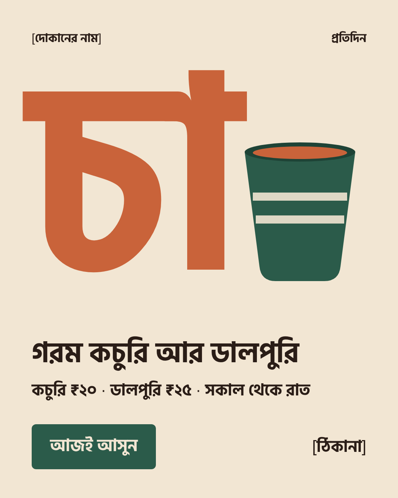
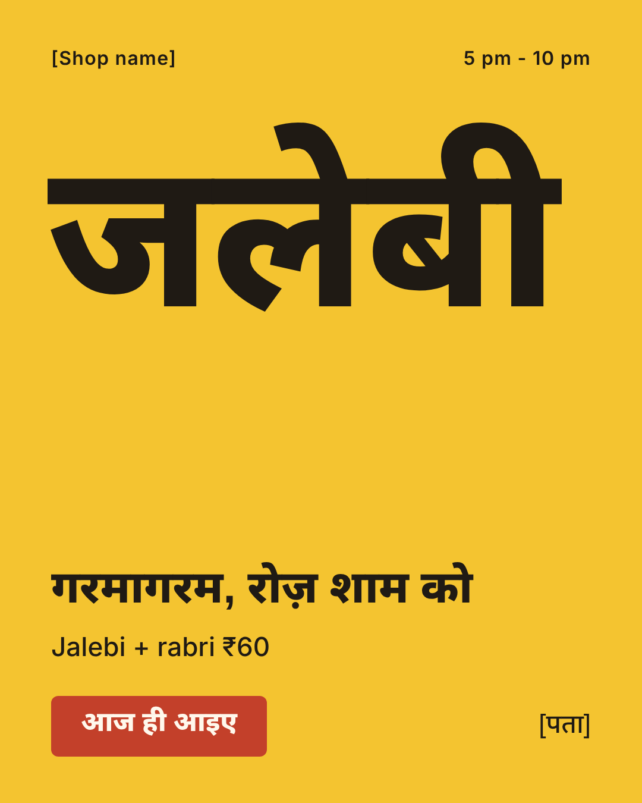
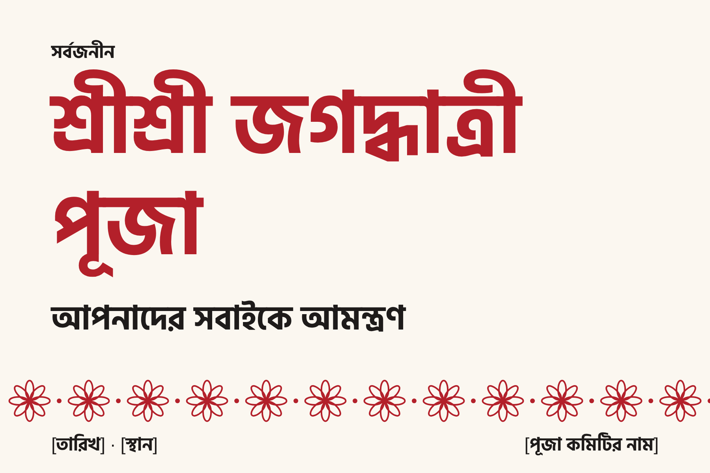

# Anti-AI Poster Design

**A model-agnostic skill that helps any AI make posters that don't look AI-generated.**

Most AI-made posters share a fingerprint: gold-gradient lettering, ornate filigree frames, a pill or ribbon behind every line, glowing glossy food, icon-in-circle grids, five fonts at once, garbled fine print. They fail because *nothing is ever removed*. This skill teaches a model to design the way a human does: **one idea, one hero, one action, then delete.**

It was built from a side-by-side analysis of 12 AI-style street banners and 8 human-designed posters (see [`references/ai-tells-catalog.md`](skills/anti-ai-poster-design/references/ai-tells-catalog.md)), and includes typography guidance for English, Bengali, Hindi (Devanagari) and other Indic scripts.

## What's inside

| Path | What it is |
|---|---|
| [`skills/anti-ai-poster-design/SKILL.md`](skills/anti-ai-poster-design/SKILL.md) | The skill: workflow, hard limits, the list of tells |
| [`references/ai-tells-catalog.md`](skills/anti-ai-poster-design/references/ai-tells-catalog.md) | Evidence: ~60 catalogued tells with IDs, measurements, replacements |
| [`references/design-system.md`](skills/anti-ai-poster-design/references/design-system.md) | 5 layout skeletons, type scale, 10 palettes, font pairings, quality tests |
| [`references/bengali-and-indic-typography.md`](skills/anti-ai-poster-design/references/bengali-and-indic-typography.md) | Indic rendering, sizing, bilingual layout, numerals, cultural notes; Hindi/Devanagari in section 9 |
| [`references/image-model-prompting.md`](skills/anti-ai-poster-design/references/image-model-prompting.md) | Two-stage workflow and prompts for Midjourney, DALL-E, Stable Diffusion, etc. |
| [`assets/template.html`](skills/anti-ai-poster-design/assets/template.html) | Starter poster with palette/type tokens |
| [`scripts/`](skills/anti-ai-poster-design/scripts) | `render_poster.py` (HTML to PNG), `poster_lint.py` (source audit), `poster_pixels.py` (image audit) |
| [`examples/`](skills/anti-ai-poster-design/examples) | Four worked posters (HTML + PNG) |
| [`PORTABLE_PROMPT.md`](PORTABLE_PROMPT.md) | One paste-able file for any chatbot |

## Examples

All copy in the examples is sample/placeholder content. Each was built with the skill and passes the linter.

| Giant Word (Bengali) | Giant Word (Hindi + English) |
|---|---|
|  |  |

| Traditional Mode (Bengali) | Ledger (English + Bengali, dark ground) |
|---|---|
|  |  |

## Use it

### Claude (claude.ai, Claude Desktop, Claude Code)
1. Download this repository as a ZIP, or download the `.skill` file from the Releases page.
2. **claude.ai / Claude Desktop:** upload the skill from your Claude skills settings.
3. **Claude Code:** copy the folder `skills/anti-ai-poster-design` into `~/.claude/skills/` (all projects) or `<your-project>/.claude/skills/` (one project).
4. Ask: *"Make a poster for my tea stall: kochuri and dalpuri, Bengali, for Instagram."* The skill triggers automatically.

### Any other AI (ChatGPT, Gemini, Copilot, local models, API)
Open [`PORTABLE_PROMPT.md`](PORTABLE_PROMPT.md) and paste everything below the line into a system prompt, custom instructions, a Gem / custom GPT, a project, or the top of a chat. It is self-contained and needs no tools.

For models that can browse a repository or read files, point them at `skills/anti-ai-poster-design/SKILL.md` and let them follow the links to the references.

### Image generators (Midjourney, DALL-E, Stable Diffusion, Imagen, Ideogram, Flux)
Follow [`image-model-prompting.md`](skills/anti-ai-poster-design/references/image-model-prompting.md): generate the *hero image only, with no text*, then add the text in any layout tool or in HTML.

## Scripts

```bash
# Render an HTML poster to PNG (Playwright+Chromium, or WeasyPrint+PyMuPDF as fallback)
pip install weasyprint pymupdf
python skills/anti-ai-poster-design/scripts/render_poster.py poster.html poster.png --width 1080 --height 1350

# Audit the source: fonts, gradients, effects, containers, colors, text size, word count, clichés
python skills/anti-ai-poster-design/scripts/poster_lint.py poster.html

# Audit the render: calm space, edge busyness, palette size, hue families
pip install pillow numpy
python skills/anti-ai-poster-design/scripts/poster_pixels.py poster.png

# Run the repo's own sanity tests
python tests/run_tests.py
```

The linter and pixel checker are heuristics. They catch objective tells; they cannot judge taste. A pass means "no known tell found", not "good design".

## Fonts

Examples use free Google Fonts (Bebas Neue, Fraunces, Inter, Hind Siliguri, Anek Bangla, Noto Sans Devanagari). The templates load them from Google Fonts when online and fall back to installed or generic fonts. Install the fonts locally for offline rendering.

## How the skill was derived (and its limits)

- The "AI" set was 12 photographed banners from a street in West Bengal, labelled AI-generated by the person who collected them; the reference set was 8 modern social-media posters. The labels are unverified.
- Photographs add glare and noise, so measured busyness is overstated. Some tells (borders, pills, contact strips) are also typical of cheap banner printing in general, with or without AI.
- The reference set is itself template-flavored, so the skill borrows *principles* (hierarchy, restraint, whitespace), not a look.
- The sample came from West Bengal. Hindi/Devanagari guidance comes from typographic practice and was checked by rendering, not from a sampled set of Hindi posters.
- The original photos are **not** included: they show real businesses and phone numbers.

Details and measurements: [`references/ai-tells-catalog.md`](skills/anti-ai-poster-design/references/ai-tells-catalog.md).

## Contributing

Issues and pull requests are welcome, especially:
- More tells (with a description and an example described in words, not a photo of a real business).
- Palettes, font pairings and examples for more scripts and regions (Tamil, Telugu, Gujarati, Arabic, CJK...). Hindi and Bengali are covered; the others are only covered by the general Indic rules.
- New layout skeletons and worked examples.
- Better heuristics in `poster_lint.py` / `poster_pixels.py`, with a test in `tests/`.

## License

MIT. See [`LICENSE`](LICENSE).
